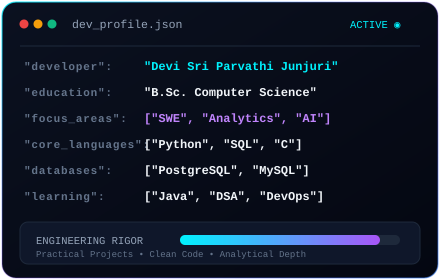
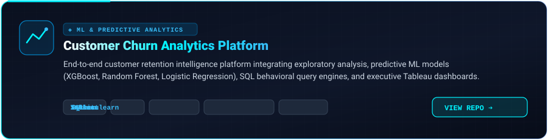
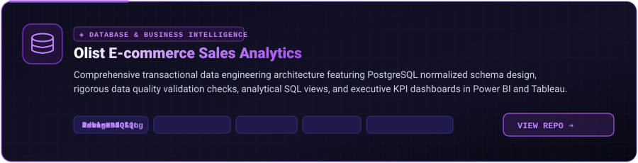
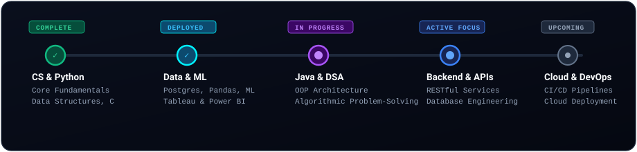

  <!-- ===================================================== -->
  <!--                     HERO BANNER                       -->
  <!-- ===================================================== -->
  

    

  <!-- Dynamic Typing Sub-Header -->
  

  

    
    
    
  

---

<!-- ===================================================== -->
<!--                     ABOUT ME                          -->
<!-- ===================================================== -->

  

<table>
  <tr>
    <td width="56%" valign="top">
      <h3>⚡ Software Engineer &amp; Data Practitioner</h3>
      

        I am a <strong>B.Sc. Computer Science</strong> student dedicated to building robust software systems, production-oriented data pipelines, and intelligent machine learning models.
      

      

        My engineering mindset centers on writing clean, modular code, understanding algorithmic foundations, and transforming complex raw data into actionable intelligence.
      

      <ul>
        <li>🎓 <strong>Academic Foundation:</strong> B.Sc. Computer Science</li>
        <li>💻 <strong>Primary Focus:</strong> Software Engineering &amp; Python Architecture</li>
        <li>📊 <strong>Analytics &amp; ML:</strong> Advanced SQL, Predictive Modeling, Exploratory Data Analysis</li>
        <li>🗄️ <strong>Data Storage:</strong> PostgreSQL schema design, integrity validation, analytical views</li>
        <li>🌱 <strong>Current Expansion:</strong> Java, Data Structures &amp; Algorithms, Backend APIs, Cloud Computing</li>
      </ul>
    </td>
    <td width="44%" valign="middle" align="center">
      
    </td>
  </tr>
</table>

---

<!-- ===================================================== -->
<!--                 TECHNICAL ARSENAL                     -->
<!-- ===================================================== -->

  

| Domain | Technologies &amp; Tools | Stack Visualization |
| :--- | :--- | :--- |
| **Programming Languages** | Python, C, SQL, Java *(expanding)* |  |
| **Data Science &amp; ML** | NumPy, Pandas, Scikit-learn, XGBoost |  |
| **Databases &amp; Storage** | PostgreSQL, Relational Schema Design, SQL Views |  |
| **Visualization &amp; BI** | Tableau, Microsoft Power BI, Matplotlib, Seaborn, Excel |  |
| **Tools &amp; Environments** | Git, GitHub, VS Code, Jupyter Notebook, Linux |  |

---

<!-- ===================================================== -->
<!--                 FEATURED PROJECTS                     -->
<!-- ===================================================== -->

  

### 01. Customer Churn Analytics Platform

- **Architectural Overview:** An end-to-end predictive analytics ecosystem designed to evaluate customer behavior patterns, determine churn probabilities, and drive data-backed retention decisions.
- **Machine Learning Pipeline:** Implemented and compared multiple supervised classification models including **Logistic Regression**, **Random Forest**, and **XGBoost** with comprehensive hyperparameter tuning and performance scoring.
- **Data Engineering &amp; BI:** Automated exploratory data analysis, feature engineering, and SQL risk segmentation, culminating in an executive **Tableau** retention dashboard.
- 🔗 **Direct Repository:** [`Customer_Churn_Analytics`](https://github.com/devisriparvathi-junjuri/Customer_Churn_Analytics)

 

### 02. Olist E-commerce Sales Analytics

- **Architectural Overview:** Enterprise data warehouse and analytics implementation transforming real-world Brazilian e-commerce transactional data into structured commercial intelligence.
- **Database Modeling:** Architected a normalized relational schema in **PostgreSQL** with primary/foreign keys, strict data integrity constraints, and optimized indexing.
- **Analytics &amp; Dashboards:** Crafted complex analytical SQL queries, window functions, and views to monitor delivery performance, regional sales distributions, and revenue KPIs rendered in **Power BI** and **Tableau**.
- 🔗 **Direct Repository:** [`olist-ecommerce-sales-analytics`](https://github.com/devisriparvathi-junjuri/olist-ecommerce-sales-analytics)

---

<!-- ===================================================== -->
<!--                 GITHUB ANALYTICS                      -->
<!-- ===================================================== -->

  

  <table border="0" cellspacing="10" cellpadding="0">
    <tr>
      <td valign="top" width="50%">
        
      </td>
      <td valign="top" width="50%">
        
      </td>
    </tr>
    <tr>
      <td valign="top" width="50%">
        
      </td>
      <td valign="top" width="50%">
        
      </td>
    </tr>
  </table>

   

  

---

<!-- ===================================================== -->
<!--              CONTRIBUTION VISUALIZATION               -->
<!-- ===================================================== -->

  

  <picture>
    <source media="(prefers-color-scheme: dark)" srcset="https://raw.githubusercontent.com/devisriparvathi-junjuri/devisriparvathi-junjuri/output/github-contribution-grid-snake-dark.svg">
    <source media="(prefers-color-scheme: light)" srcset="https://raw.githubusercontent.com/devisriparvathi-junjuri/devisriparvathi-junjuri/output/github-contribution-grid-snake.svg">
    
  </picture>
  

    <em>Automated daily contribution snake generated via GitHub Actions workflow (<code>.github/workflows/snake.yml</code>)</em>
  

---

<!-- ===================================================== -->
<!--                   LEARNING ROADMAP                    -->
<!-- ===================================================== -->

  

  

 

| Milestone | Core Topics | Status | Target Deliverables |
| :--- | :--- | :--- | :--- |
| **01. CS &amp; Foundations** | Computer Science Principles, C, Python Syntax | `COMPLETED` | Academic coursework &amp; algorithmic foundation |
| **02. Data Engineering &amp; ML** | PostgreSQL, Pandas, NumPy, XGBoost, BI Dashboards | `DEPLOYED` | Production analytics repositories &amp; KPI dashboards |
| **03. OOP &amp; Problem Solving** | Java, Object-Oriented Principles, Data Structures &amp; Algorithms | `IN PROGRESS` | LeetCode mastery &amp; scalable object modeling |
| **04. Backend Architecture** | REST APIs, Database Optimization, Microservices | `ACTIVE FOCUS` | Backend service integration &amp; API engineering |
| **05. Cloud &amp; DevOps** | Docker, CI/CD Automation, Cloud Infrastructure | `UPCOMING` | Containerized deployments &amp; cloud pipelines |

---

<!-- ===================================================== -->
<!--                CONNECT & COLLABORATE                  -->
<!-- ===================================================== -->

  

  

    I am actively seeking software engineering internships, collaborative development projects, and data/AI opportunities.
  

  

    
    &nbsp;&nbsp;
    
    &nbsp;&nbsp;
    
  

   

  

